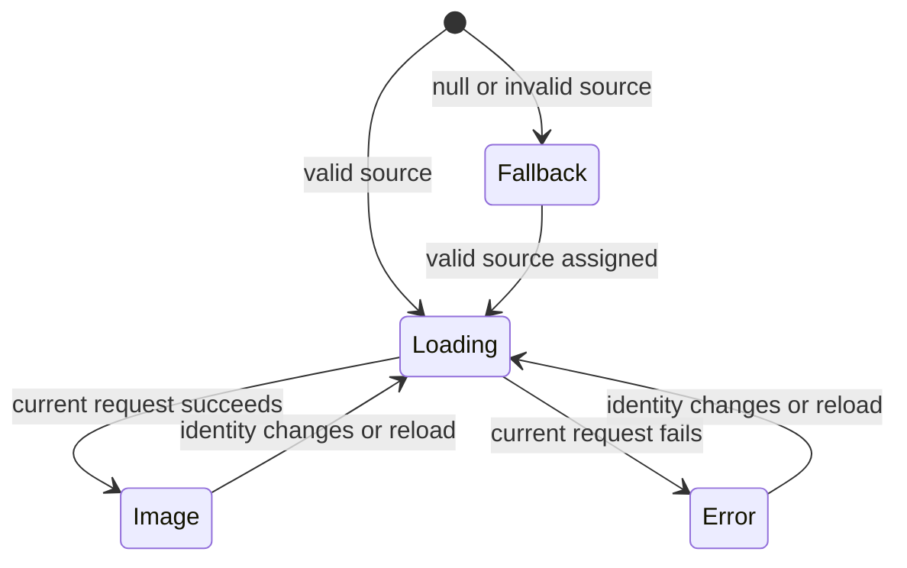

# Native Image Spec

## 1. Implementation status and authority

This document is the behavioral contract for
`@onekeyfe/react-native-image`. iOS uses SDWebImage and Android uses Glide; their
cache keys, decode pipelines, and callbacks are independent. This spec names the
shared semantics and records deliberate differences so they remain visible in
review.

The OneKeyImage functionality in §§2–11 is implemented. The independent named
icon component in §12 is implemented; its platform acceptance status is recorded
separately in §12.6. The table below records
implementation status only; validation evidence is tracked separately in §11.

| Area                                                     | Implementation status          |
| -------------------------------------------------------- | ------------------------------ |
| Public TypeScript API and native bridge                  | Implemented                    |
| Loading, fallback, cancellation, and recycling ownership | Implemented on iOS and Android |
| Decode and encoded-data safety limits                    | Implemented on iOS and Android |
| TOS rendition selection                                  | Implemented on iOS and Android |
| Synchronous memory probe and cross-size preview          | Implemented on iOS and Android |

## 2. Scope and non-goals

OneKeyImage owns source normalization, native request execution, decoding,
display state, native loading/fallback presentation, cache operations, request
cancellation, and safe reuse of a native view.

It supports URI sources and React Native numeric assets resolved to a URI. It
provides a React wrapper, a Nitro native view, cache/preload methods, and a
native-only reusable host for native list cells.

The component does not own application image selection, authentication token
refresh, business placeholders, list identity, or layout size. Callers must
provide stable dimensions and a `recyclingKey` when a view is reused for
different logical content.

## 3. Definitions and ownership

- **Raw URL:** the caller-provided source before TOS optimization.
- **Request URL:** the optimized rendition URL, or the raw URL when optimization
  is disabled, unsafe, unsupported, or retried after an ordinary optimized-load
  failure.
- **Exact memory hit:** a decoded memory entry whose request URL and requested
  decode dimensions match the current request identity.
- **Cross-size preview:** a decoded static image from the same family at another
  compatible size, displayed temporarily while the exact request continues.
- **Family:** raw URL plus canonical request-header digest. Different headers
  never share a family.
- **Variant:** a request URL and decode width/height. Android also includes the
  circular transform because Glide caches transformed resources.
- **Terminal request:** the current request generation that exclusively owns
  `onLoad` or `onError`, followed by `onLoadEnd`.

SDImageCache and Glide remain authoritative for cached resources. The
cross-size registry stores bounded hints that reproduce cache keys; it does not
own image bytes and a stale hint is removed after a memory miss.

## 4. Public contract

### 4.1 Source and display props

| Input                         | Contract and default                                                                                                                                   |
| ----------------------------- | ------------------------------------------------------------------------------------------------------------------------------------------------------ |
| `source`                      | URI source or numeric React Native asset. Null, blank, or unresolved input shows fallback without `onError`.                                           |
| `variant`                     | `generic` by default; also `token`, `network`, and `avatar`. Selects native placeholder/fallback presentation, not cache identity.                     |
| `contentFit`                  | `cover` by default; also `contain`, `fill`, and `center`. Affects display and decode sizing.                                                           |
| `cachePolicy`                 | Explicit prop, then source-level value, with `memory-disk` as the final default.                                                                       |
| `autoplay`                    | Defaults to `false` on Android and `true` on other native platforms. Callers requiring parity must pass it explicitly.                                 |
| `recyclingKey`                | Part of request generation/signature. A change cancels stale work and resets ownership.                                                                |
| `optimizeTos`                 | `true` by default. It may replace eligible OneKey asset URLs with a bounded rendition URL.                                                             |
| `resizeWidth`, `resizeHeight` | Optional logical-size hints used by preload, TOS selection, and pre-layout memory probing. One dimension alone implies a square preload decode target. |
| `overscan`                    | `1.1` by default. Values below 1 are normalized by the TOS selector.                                                                                   |
| `round`                       | `false` by default. Clips the native host to an oval; Android includes its circle transform in decoded cache identity.                                 |
| `loadingStrategy`             | `static` by default; `skeleton` and `none` are supported. A React `placeholder` disables the native loading strategy for that instance.                |
| `placeholderColor`            | Optional theme-aware native color for loading and terminal native states.                                                                              |

On iOS, an explicit `round` value updates the shape while a source is active.
A native `nil` during a Fabric prop reset retains the last committed shape until
an explicit value arrives or a new source is committed after reuse. The React
wrapper supplies `false` when the prop is omitted.

React `placeholder` and `fallback` are optional overlay content. Their container
clips to the same rounded bounds as the native image and does not receive pointer
events.

### 4.2 Methods and cache API

- `reload()` invalidates the last request signature and starts the current
  source again.
- `cancel()` cancels current work, invalidates stale completions, and returns the
  view to a non-requesting loading state.
- `preload(sources)` resolves `true` only when every valid source succeeds. The
  JavaScript wrapper filters blank sources but returns `false` if any were blank.
- `clearMemory()`, `clearDisk()`, and `clearAll()` resolve only after their native
  cache work is complete. Memory clearing also clears cross-size hints.

## 5. State and event contract

The observable native states are loading, image, error, and fallback.

For a valid request, the terminal event order is:

1. `onLoadStart`
2. exactly one of `onLoad` or `onError`
3. `onLoadEnd`
4. `onDisplay` after a successful image is attached and visible in a window

`onDisplay` is not a terminal pair member and may occur later. A null source
shows fallback without a request and without `onError`.

Each source or identity change advances a native generation. Only the current
generation may mutate the view or emit terminal callbacks. Cancellation,
recycling, and disposal invalidate previous generations and release active
request, display, retry, safety, skeleton, and animation work.

A cross-size preview is presentation only. It MUST NOT emit `onLoad`,
`onError`, `onLoadEnd`, or `onDisplay`; the exact request retains callback
ownership. An iOS exact synchronous memory hit is terminal and reports
`cacheType: memory`. Android may show an exact decoded entry synchronously as a
preview, while the normal Glide request remains terminal; this is a recorded
library-level divergence rather than a different public success result.

## 6. Cache identity and synchronous memory probe

### 6.1 Exact identity

Cache identity includes the effective request URL, canonical request headers,
decode dimensions, and native decoder/transformation inputs. Request signatures
also include caller identity and layout inputs needed to prevent a recycled view
from accepting an obsolete result.

Headers are part of identity even when the URI is unchanged. TOS optimization is
disabled for requests with custom headers so an authenticated source is not
silently rewritten.

There is no fixed “three sizes per image” cache contract. TOS currently has five
layout tiers and up to two density renditions per tier. The memory-variant
registry records the variants actually requested, with a maximum of eight hints
per family.

### 6.2 Probe behavior

For `memory` and `memory-disk` policies, a prop change may probe decoded memory
synchronously on the UI thread before layout when size hints are available. No
disk or network work is allowed in this probe. Android MUST disable Glide disk
cache access for the probe and accept only a resource delivered synchronously
from decoded memory.

The probe order is:

1. Exact optimized request URL and dimensions.
2. Exact raw-URL fallback and dimensions when different.
3. The smallest cached variant at least as large in both dimensions.
4. The largest cached variant at most as large in both dimensions.

Cross-size candidates must belong to the same family and their aspect-ratio
drift must be at most 1.1. Animated resources are excluded. On Android, a square
target cannot reuse a circle-cropped bitmap; a circular target may reuse an
uncropped bitmap because the host clips it.

An approximate hit remains visible as the loading placeholder until the exact
request replaces it. This avoids a blank or skeleton frame while preserving the
quality and event semantics of the exact request. A cross-size preview for
`contentFit: center` is temporarily rendered with aspect-fit scaling so a
smaller image fills the intended visual area and a larger image is not clipped.
The cached bitmap is not resampled or copied. The exact image restores `center`
and replaces the preview in the same UI-thread delivery. Replacing a visible
preview MUST NOT run a whole-view fade that makes the preview disappear first.

Terminal error or fallback, cancellation, recycling, and disposal release
preview ownership. A later request for the same family may probe memory again.
`disk` and `none` policies do not participate in synchronous previews.

The registry is bounded to 1,024 families and eight variants per family. Family
access is recency-ordered; new variants evict the oldest retained hints. A cache
miss removes the stale variant immediately.

## 7. TOS rendition and decode contract

Eligible hosts are limited to OneKey's declared asset domains. Optimization is
skipped for SVG/video paths, protected or signed queries, custom request headers,
invalid sizes, and non-allowlisted hosts. Ordinary failure of an optimized URL
may retry the raw URL; a safety rejection MUST NOT bypass its limit by retrying.

| Maximum logical edge | Standard rendition | High-density rendition |
| -------------------: | -----------------: | ---------------------: |
|                   48 |                 96 |                    160 |
|                   96 |                192 |                    320 |
|                  192 |                384 |                    640 |
|                  384 |                768 |                   1280 |
|               larger |               1280 |                   1280 |

Display size selects the tier first. Normalized density and overscan only choose
between that tier's standard and high-density rendition. Device density is
clamped to 1–3.

Rendered and preloaded requests must use equivalent logical-size, pixel-ratio,
overscan, headers, cache policy, and optimization inputs when the caller expects
an exact decoded-memory hit.

### 7.1 Embedded PNGs in SVG foreign objects — Implemented

The native image decoder, including preload and reusable native-list hosts,
recognizes SVG content independently of URL extensions. A `foreignObject`
containing exactly one XHTML `img` with a base64 PNG source may be converted
to an SVG `image`. The image must fill the explicitly sized foreign-object
viewport; its geometry, transform, opacity, mask and clip remain in the SVG.
Eight-digit hexadecimal paint attributes are translated to RGBA for both
backends so the retained background and its alpha do not become black.
Converted iOS thumbnails compensate for SVGCoder's screen-scale rasterization:
requested physical pixels are not multiplied by display density again. Their
output canvas is capped at 4,194,304 pixels, matching the 16 MiB decode target.
This is a static image subset, not an HTML renderer. Other HTML, external
sources, unsupported attributes/layout/CSS, malformed XML, DTDs and entities
fail decoding instead of reporting a partially rendered image as successful.

Normalization runs in the existing native decode job, never in a synchronous
UI memory probe or a JS runtime. Existing request generations, cancellation,
thumbnail sizing and native caches retain ownership. No WebView or additional
network request is created. The native cache generation changes so earlier
partially decoded SVGs cannot bypass the new decoder after an upgrade.

Documents requiring conversion are limited to 8 MiB, 10,000 XML elements,
64 levels and 16 foreign objects. Embedded PNGs share an aggregate 8 MiB encoded
and 4,194,304-pixel budget, have sides at most 8,192, and must be static.
The bounded PNG must also pass the platform raster decoder before conversion;
a valid metadata header alone is insufficient to claim successful rendering.
Only full-viewport `img` dimensions (omitted or `100%`) are supported. The
supported HTML stylesheet is an `img` rule containing only full-viewport width
and height and nearest-neighbor image-rendering declarations. Unsupported
foreign-object documents return the ordinary image-error/fallback result.
Ordinary SVGs without foreign objects keep their existing decoder path.

Acceptance requires the real On-Chain All-Stars #1982 document, a standard SVG,
an unsupported HTML subtree, malformed and over-budget embedded PNGs, cached
reloads and recycled hosts on both platforms. Source completion alone does not
establish runtime or full-wallet acceptance.

Focused regression coverage is in `OneKeySVGForeignObjectTests.swift` and
`OneKeySVGForeignObjectTest.kt`; cache-identity expectations remain in the
existing infrastructure/safety suites. The real #1982 source has been rendered
with the production iOS coder on iOS Simulator and the production Android SVG
decoder in an Android emulator Activity. Both reject unsupported HTML. This
records decoder-level runtime evidence. The iOS wallet also displays the
all-networks NFT list in light/dark themes and an On-Chain All-Stars detail.
Thirty downward swipe gestures and a return to cached rows completed without
an app restart, but the current list reached its end early; this does not
establish thirty distinct screens or physical-device crash acceptance.
Android full-wallet acceptance remains open. Native interpolation may differ
from browser CSS pixelation.

## 8. Safety and resource limits

Both platforms reject oversized or malformed encoded data before allowing an
unbounded decode. Static and animated paths have separate limits.

| Limit                        |                         iOS |                  Android |
| ---------------------------- | --------------------------: | -----------------------: |
| Encoded image                |                      32 MiB |                   32 MiB |
| Decoded data URI             |                       8 MiB |                    8 MiB |
| Animated encoded image       |                      16 MiB |                   16 MiB |
| Static metadata dimensions   | 100,000,000 px; side 32,768 |                     same |
| Animated frames              |                       1,000 |                    1,000 |
| Animated duration            |                        60 s |                     60 s |
| Animated metadata dimensions |   16,000,000 px; side 8,192 | 4,194,304 px; side 8,192 |
| Decode/frame buffer target   |                      16 MiB |                   16 MiB |

The animated-dimension difference reflects different native decoder allocation
behavior and is intentional. Safety failures are terminal request failures and
must clean up request and safety-flight ownership.

## 9. Platform mapping and known divergences

| Contract                  | iOS                                                     | Android                                                                |
| ------------------------- | ------------------------------------------------------- | ---------------------------------------------------------------------- |
| Image pipeline            | SDWebImage / `SDAnimatedImageView`                      | Glide / native `ImageView`                                             |
| Exact synchronous hit     | May complete the current request immediately            | Displays immediately; Glide request remains terminal                   |
| Cross-size preview        | Direct decoded `UIImage` lookup by reproduced cache key | Disk cache disabled; accepts only an immediate decoded-memory callback |
| Circular output           | Host view corner mask                                   | Circle-cropped Glide resource plus host clipping                       |
| Default autoplay          | `true`                                                  | `false`                                                                |
| Preload scheduling        | Up to four concurrent tasks                             | Sequential source loop                                                 |
| Native-only reusable host | `OneKeyImageReusableView`                               | `OneKeyImageReusableView`                                              |

The shared contract is the result and ownership described above. It does not
require SDWebImage and Glide to expose identical internal cache behavior.

## 10. Conformance map

| Concern                           | Shared/API                                  | iOS                               | Android                                                  |
| --------------------------------- | ------------------------------------------- | --------------------------------- | -------------------------------------------------------- |
| Public props, overlays, cache API | `src/index.tsx`, `src/OneKeyImage.nitro.ts` | generated bridge                  | generated bridge                                         |
| Request lifecycle and reuse       | wrapper identity state                      | `ios/OneKeyImage.swift`           | `OneKeyImage.kt`                                         |
| Request context and identity      | header serialization                        | `OneKeyImageRequestContext.swift` | `OneKeyImageSafety.kt`, `OneKeyImage.kt`                 |
| Cross-size hints                  | —                                           | `OneKeyImageMemoryVariants.swift` | `OneKeyImageMemoryVariants.kt`                           |
| Preload and cache clearing        | wrapper input normalization                 | `OneKeyImageCache.swift`          | `OneKeyImageCache.kt`                                    |
| TOS rendition selection           | —                                           | `OneKeyTosURL.swift`              | `OneKeyTosUrl.kt`                                        |
| Decode/safety policy              | —                                           | `OneKeyImageRequestContext.swift` | `OneKeyImageSafety.kt`, `OneKeyImageDecodeDimensions.kt` |

## 11. Review checklist

For any change to Native Image:

- [ ] Does a new input affect request signature, cache identity, or family
      identity?
- [ ] Can a stale request, fallback retry, display callback, or preview write
      after cancellation or recycling?
- [ ] Does a preview remain callback-silent while the exact request owns the
      terminal event pair?
- [ ] Are memory probes synchronous and memory-only, with stale hints removed?
- [ ] Are animated images excluded from cross-size reuse?
- [ ] Do `memory`, `disk`, `none`, and `memory-disk` retain their documented
      memory/disk behavior?
- [ ] Do render and preload compute compatible URL and decode identities?
- [ ] Are new bounds numeric, enforced, and cleared or evicted deterministically?
- [ ] Is every intentional iOS/Android difference recorded in §9?
- [ ] Does the implementation still match this spec, or must this spec change in
      the same PR?

### Acceptance matrix

| Area           | Required cases                                                                                    | Pass condition                                                                                                                                          |
| -------------- | ------------------------------------------------------------------------------------------------- | ------------------------------------------------------------------------------------------------------------------------------------------------------- |
| Identity       | Same URL with different headers, sizes, fit, round, policy, and recycling keys                    | No cache or stale-result ownership crosses an incompatible identity                                                                                     |
| Memory preview | Exact, larger, smaller, `center`, incompatible aspect ratio, stale hint, animated entry           | Compatible static entries display immediately; cross-size `center` scales without a blank frame; disallowed entries are ignored and stale hints removed |
| Lifecycle      | Rapid source changes, reload, exact-request failure after preview, cancel, recycle, detach/attach | Only the current generation writes and emits one terminal pair; preview ownership is released on terminal failure                                       |
| Loading UI     | Native static/skeleton/none and React placeholder/fallback                                        | One loading surface is visible; clipping and terminal state are correct                                                                                 |
| TOS            | Every tier, DPR boundary, protected query, headers, unsupported path, optimized failure           | Correct rendition or raw URL; only ordinary optimized failure retries raw                                                                               |
| Safety         | Encoded, dimension, frame, duration, and decode-buffer boundaries                                 | At-limit input follows the supported path; over-limit input fails and cleans up                                                                         |
| Cache API      | Preload mixed success, memory/disk/all clearing                                                   | Promise result is accurate and requested cache work plus hints are complete                                                                             |
| Native reuse   | Standalone Nitro view and reusable list-cell host                                                 | No stale image, callback, animation, skeleton, or request survives ownership change                                                                     |

The implementation is complete on iOS and Android. Source tests and native
builds verify the implementation at their respective layers. Simulator or device
runs add rendered lifecycle and visual acceptance evidence; missing acceptance
evidence does not indicate missing implementation.

## 12. Named SVG icon component — Implemented

### 12.1 Scope and ownership

`@onekeyfe/react-native-image/icon` provides `OneKeyIcon` on iOS, Android,
Web and Desktop. This is independent of OneKeyImage: its existing props,
URI pipeline, caches and events remain unchanged. This phase does not migrate
NativeList, BottomTabs, Activity, Market or the application's Icon adapter.

The canonical artwork is the application's `packages/components/svg` directory.
Generation accepts an explicit `--app-root`, includes all 1,908 current source
files, and uses the existing application icon naming convention. It rejects
duplicate names, invalid XML, external references and unsupported currentColor
locations before writing any output. It does not scan usage or remove icons.
Generated raw files have unique `IconName.svg` names in one resource directory
shared by the iOS resource bundle and Android assets. Source paths and digests
are recorded in a deterministic manifest; paths and SVG markup are not embedded
in a JavaScript icon map. Existing application React SVG generation is unchanged.
The current React registry also exposes `ChartPositionOutline` without a matching
canonical SVG file. This component does not invent that missing source; a later
application adapter migration must resolve that existing source gap explicitly.
An absent root namespace is preserved; an explicitly wrong namespace is rejected.
The current `GooglePayIllus` source contains a local clip reference without its
definition. Generation reports that diagnostic and preserves the raw reference;
the sprite prefixes even unresolved local references so they cannot resolve to
another symbol. It does not invent clipping geometry or silently repair sources.

Native resources belong to the native SDK/package version. Adding or changing
an icon requires rebuilding that native package; JavaScript OTA alone cannot
install missing native artwork. On iOS/Android the native service and bounded
cache are process-owned, while `main` and `bg` JavaScript heaps remain separate.
The view is for the UI `main` runtime; importing or initializing `bg` MUST NOT
load artwork or start icon rendering. Web/Desktop use one application JS runtime;
Electron's renderer and operating-system resources remain separate owners.

### 12.2 Public API and presentation

The independent entry exports `OneKeyIcon` and its props: required `name: string`,
optional `color: string`, plus standard React Native view `style`, accessibility
and `testID` props. It is a leaf view and does not accept children.
No arbitrary XML, URI, preload/cache methods or error events
are exposed. The native bridge uses `iconName` to avoid a collision with
`HybridObject.name`.
The Web entry MUST NOT import the root image entry or runtime Nitro code.

The default logical size is 24 × 24 and the default color is opaque black.
Explicit style dimensions take precedence. Artwork is aspect-fit and centered
inside those bounds, preserving its source viewBox, opacity, masks, clipping,
gradients, strokes and fixed colors. `color` resolves only source `currentColor`
tokens in `fill`/`stroke` attributes; it is not whole-image tint. Supported native color
inputs are `#RGB`, `#RGBA`, `#RRGGBB`, `#RRGGBBAA`, `rgb(r,g,b)` and
`rgba(r,g,b,a)`. RGB channels are integers in 0–255; alpha is a finite number in
0–1. Native alpha is quantized to the nearest 8-bit channel (including tiny alpha
rounding to zero). Native percentages, named colors and theme tokens are not
accepted; invalid native colors clear the drawing rather than reusing a stale
one, and development builds log a `[OneKeyIcon] Unsupported color` warning
naming the icon so a blank icon is diagnosable. Web colors follow browser CSS semantics, including named colors, variables
and inheritance; caller style takes precedence over the color prop and the inner
SVG inherits currentColor.
Native implementations receive a normalized RGBA value. The later application
adapter owns theme resolution and RTL name selection; this component does not
infer either from a name. Accessibility names are caller supplied; decorative
icons do not acquire their internal resource name as an accessible label.

Unknown/empty names, invalid native color, invalid/non-finite/zero layout or a decoder
failure clear the current image while retaining the view's layout. They MUST NOT
display the previous icon or silently substitute another artwork. There is no
network request or disk image-cache write.

### 12.3 Lifecycle, threading and resource limits

Native prop, layout and attachment updates occur on the UI thread. A change of
name, color, pixel size or display scale advances a generation and clears the
previous drawing. Detach/recycle invalidates that generation; only a completion
matching the current attached generation may bind an image. Reattachment starts
the current identity again. Before queuing, the view probes the decoded-raster
LRU synchronously on the UI thread; a hit binds in the same frame (no blank frame
on remount or recycle). The probe never reads assets or loads the manifest, so
a cold process still takes the asynchronous path. Decoding runs off the UI thread with at most two
concurrent tasks per process. Each view owns at most one pending identity;
replacement or detach removes/replaces that queued identity instead of appending
obsolete closures. Obsolete queued work is discarded before decoding and
obsolete running results are discarded on completion.

The host must package `OneKeyIcons.bundle` (iOS) or `assets/icons` (Android);
when its manifest is missing or invalid the native side logs one warning
(`[OneKeyIcon]` / tag `OneKeyIcon`) and every named icon stays blank.

The native decoded-raster LRU is limited to 128 entries and 8 MiB of pixel cost.
Its key includes canonical name, source digest, normalized RGBA, requested pixel
width/height and scale. Every input that changes pixels changes identity. A
single larger result may display but is not cached; it is never reduced merely
to fit the cache budget. Each decode target is limited to 4,096 pixels per edge
and 4,194,304 pixels total (16 MiB at four bytes/pixel). Non-finite, zero or
over-limit targets fail without allocating a raster. Concurrent decode buffers
and currently displayed images are additional memory; the cache limit is not a
total process-memory guarantee. Resources and cache entries are native shared
data, not copies serialized into each JavaScript heap.

iOS reuses the already declared SDImageSVGCoder decoder. Android reuses the
already declared AndroidSVG decoder. Native color substitution is restricted to
generation-validated fill/stroke attribute tokens and preserves literal colors. The public
resolved CSS RGBA/cache identity is unchanged. Decoder-local serialization uses
decimal alpha endpoints on iOS and nearest 8-bit `#RRGGBBAA` on Android, avoiding
the native parsers' integer-endpoint / 256-step rgba behavior. Source fixed
colors and raw loader bytes are not rewritten by these named-color rules.
Unsupported source compatibility MUST be reported during acceptance; no silent
fallback, custom SVG renderer or new decoder dependency is part of this phase.

### 12.4 Web assets and packaging

Web uses one generated external sprite and a thin `<svg><use>` wrapper. Each
symbol and its internal IDs/references are namespaced by canonical icon name.
The resource URL is emitted by the consumer's existing SVG asset pipeline;
JavaScript contains the URL and names, not individual SVG paths or TSX modules.
The complete sprite initially costs approximately 1.15 MB before compression;
this design does not promise a smaller initial download. HTTP and Electron's
production `file:` protocol MUST work under the application's existing CSP and
`webSecurity: true`; development HTTP alone is insufficient acceptance.

The SDK ships no artwork. `#onekey-icon-assets` must be aliased to the host's
generated icon table; the packaged fallback returns no href (so named icons,
including NativeList's built-in Web icons, render blank) and, when `__DEV__`
is defined and true, logs one `[OneKeyIcon]` warning naming the missing alias.

### 12.5 Generation and acceptance

The generation command validates the full source set before writing, produces
stable ordering without machine paths/timestamps, and has a read-only `--check`
that rejects missing sources, invalid semantics and stale generated resources.
Tests cover repeat generation and failure without partial writes. Native raw
resources and the external sprite must be present in the packaged artifact.

Acceptance distinguishes parsing, decoding, actual rendering and lifecycle:

- Decode all 1,908 named resources with each existing native decoder. Source
  XML validity alone is not decoder support or rendering equivalence.
- Render representative currentColor fills/strokes, fixed/mixed colors, alpha,
  Bot, non-square Apple, gradients, masks and clipping against source baselines.
- Exercise rapid name/color/size updates, detach/reuse, invalid names and cache
  bounds; no obsolete result may replace the current image.
- In real browser and Electron, verify external resource loading, red/blue
  currentColor changes, fixed-color retention, repeated gradient/mask symbols,
  caller accessibility, and absence of path/TSX data from the JS wrapper.
- Run package TypeScript, focused tests, generated-output check, and native
  compilation/runtime checks where available. Record missing runtime evidence
  explicitly; generated code and successful builds do not prove device visuals.

### 12.6 Acceptance status

| Layer | Current evidence |
| --- | --- |
| Generator | All 1,908 canonical SVGs, 1,910 outputs; exact source-name coverage, diagnostics, namespace/reference tests, no-partial-write, idempotence and read-only check pass. |
| iOS integration | Real OneKeyImage Pod target builds for arm64 iOS Simulator, including new Swift view/service, actual generated Nitro bindings and resource bundle. All 1,908 bundled SVG digests match the manifest. |
| iOS tests | Existing OneKeyImage-Unit-Tests target compiles. A real UIApplication fixture executes all four focused XCTest cases with zero failures and zero skips. Ordinary hostless execution passes the three service cases and explicitly skips the UIWindow case; screenshot output is optional when the evidence environment variable is absent. |
| iOS runtime | Verified for the SDK fixture on iPhone 16 / iOS 18.6: all 1,908 resources decode; actual production HybridOneKeyIcon views pass rapid name/color updates, resize, zero-size/unknown clearing, detach/reattach and reuse. Cache entry/byte limits and coalesced queue ownership pass. Fifteen representative renderings cover fixed/mixed colors, gradients, masks, clipping and non-square aspect fit; this is not full visual acceptance of all 1,908 images or product App integration. |
| Android runtime | Existing platform instrumentation runner passes full 1,908-source decode/draw, mixed-color alpha, native-view updates/reuse and bounded-cache/queue probes on the task-owned API 34 simulator. Representative masks, clipping and gradients have source-render comparisons; backend antialiasing can differ. |
| Web/Desktop | Independent source and locally packed built Web entries emit an external sprite. Real Chromium HTTP and isolated Electron production `file:` with CSP and `webSecurity: true` render representative artwork, theme/fixed colors, repeated gradients, invalid names and caller accessibility. No application-wide Icon migration or signed release acceptance is claimed. |

Evidence and commands are retained outside product sources under this worktree's
`.tmp/ok-65959-evidence/icon-foundation-probe`. No SDK publication or application
dependency upgrade is included in this implementation status.

The initial external simulator set was blocked by CoreSimulatorService EPERM;
runtime acceptance used a specifically authorized independent temporary internal
set, without changing global simulator settings. Half-transparent blue has alpha
128 at all three solid dot interiors and alpha zero in distant background.
Rasterized edge samples reached alpha 134; that edge difference is retained as
diagnostic evidence rather than attributed to a particular decoder stage or used
to claim exact pixel parity between rendering backends.

## 13. Shared NativeList / BottomTabs SVG integration — Implemented

Image owns named SVG resources, byte decoding and Web sprite references.
NativeList and BottomTabs reuse them without changing OneKeyImage/OneKeyIcon
JavaScript props or introducing third-party dependencies, loaders or renderers.

Native modules may call existing `OneKeyNamedSVG.shared/request/cancel`;
construction and cache state stay controlled by image. Inputs remain owner,
canonical name, resolved RGBA, pixel dimensions, scale and completion. The
two-worker, 128-entry / 8 MiB raster limits remain. Completions run on the UI
thread; cancellation removes pending work, while caller revisions reject stale
in-flight results. No source XML or URI is added to the Nitro/JS interface.

Raw SVG is a separate synchronous, uncached native facility. The existing iOS
CoderBridge exposes SDImageSVGCoder decoding; existing loaders retain source
detection. An Android native helper owns the existing AndroidSVG parse/render core. No raw decoder creates a
loader, cache, worker or main-queue hop. RCT/Coil own download, scheduling,
cancellation and error delivery. Intrinsic/viewBox sizing is retained when no
target is supplied; generic URI images do not inherit named-icon raster limits.
Image's Glide PictureDrawable route retains its existing output semantics.

A separate Web DOM subentry exposes `createNamedIcon(document, name)`: it returns
an aria-hidden 24 × 24 SVG with an external `use` reference. It and the React Web
entry share one sprite URL module. The DOM entry imports no React, React Native
or Nitro runtime and embeds no path map. Callers may set width/height/styles;
currentColor, CSS variables and inherited colors remain browser-owned rather
than passing through native literal-color normalization.

NativeList owns platform coverage and legacy aliases. BottomTabs adds an
image SDK peer, CocoaPods dependency and Gradle project dependency. Its iOS
RCTImageDataDecoder registration/RCT loader/SF Symbols/tint and Android Coil
network/ordinary-image/cache/FILL/EXACT behavior remain; only SVG decoding moves.
No Web tabs implementation is added. Existing BottomTabs loader races remain
outside this migration and must be reported against a baseline, not silently
fixed. Acceptance requires real consumer slots and reuse, raw SVG beside ordinary
images, native compilation, Web/Electron DOM and packaged-resource verification;
compilation alone is not runtime acceptance.

Focused integration validation records native compilation, iOS XCTest service
and actual view execution, real RCT/Coil consumer fixtures, and Web source/lib
plus Electron file-protocol paint/interaction separately. All 1,908 sources are
decoded through the shared named path on each native platform; representative
rendering is not a claim of pixel equivalence for every source. The external
sprite's full initial transfer and native resource/OTA version limits remain.

The independently reproduced Android OneKeyIcon same-identity reattach issue is
addressed as a prerequisite of the global adapter in section 14. NativeList's own
explicit attached state remains covered by its focused lifecycle regression.

## 14. Global application Icon adapter — Implemented; runtime acceptance recorded separately

The App components package consumes the independent `./icon` entry through an
explicit local candidate package until a separately approved SDK release. Its
existing Icon names, theme/size variants, 76 RTL name mappings and default image
accessibility role remain. Generated JavaScript contains only names and RTL
metadata; individual SVG React components and their module-loading caches are
removed. Prefetch/warm entry points retain asynchronous completion compatibility
but do not promise resource decoding or warming. Extension background stubs stay
UI-free and do not import the native component. Main/background JS heaps remain
isolated on native; the process-owned native raster cache is shared.

ChartPositionOutline is restored as canonical SVG from the existing four-path
React definition without changing geometry, bringing complete resources to 1,909.
The QRCode story logo becomes a same-position sibling overlay because native
views cannot be embedded in SVG groups. Its synchronous brand mark, symbol-ready
callback, quiet zone and sharing behavior remain; symbol-ready does not promise
completion of the asynchronous named logo. Artwork consumers use the same global
Icon entry. No general SVG prop API or App-wide SVG drawing replacement is added.

Web accepts browser CSS colors (including variables/inheritance) on the outer
host, with caller style taking precedence over its default color. The inner SVG
inherits currentColor, so Tamagui hover/group styles and theme changes reach the
painted resource. Native retains validated literal RGBA and existing aspect fit.
The App adapter preserves explicit non-square outer sizes.

Android OneKeyIcon records attachment before lifecycle refresh; pending completion
while detached cannot suppress a fresh same-identity request after reattachment.
The existing two-worker, 128-entry/8 MiB native cache and identity rules are unchanged.
Acceptance includes generator read-only/idempotent checks, exact ChartPosition
source comparison, Android pending-detach regression, actual theme/pseudo-state
SVG paint and QR/artwork integration, plus true local source/built package
resolution. Publication, formal App version pins and signed release acceptance
remain separate decisions.

The current catalog contains 1,909 SVGs (1,911 generated outputs). Earlier
foundation/integration evidence in sections 12–13 records the initial 1,908
source catalog. The current focused iOS UIApplication fixture passes five XCTest
cases; Android passes all four default decoder/view cases including the original
pending-detach regression and all 1,909 named-resource completions. These are SDK
fixtures, not a full installed wallet App acceptance.

Compatibility retains observed baseline limitations: arbitrary numeric `size`
values and standalone `hoverStyle` follow the old adapter; explicit width/height,
size tokens and group hover remain supported. Runtime RTL changes require the
consumer's normal remount/restart; the adapter resolves the current RTL flag when
rendered. Standard Web image semantics belong to the real outer host and its
inner SVG stays aria-hidden. The QR logoSvg/brandMark combination is not used by
existing callers; only logoSvg moves out of the SVG drawing order.

This stage is a local-candidate integration: components points explicitly to an
unpublished file tarball, while formal mobile SDK pins and the install lock stay
unchanged. Local verification overrides one root node_modules SDK instance. A
separately approved publish/version alignment is required before clean CI/release
installation; the published alpha.395 package is not claimed to export icon.

## 15. Shape cache, native recoloring and demand-loaded Web icons — Implemented; scoped runtime acceptance

This revision preserves all 1,909 canonical resources and the existing JS props.
It supersedes the full external sprite runtime in sections 12–14: Web generates
one external SVG symbol file per name and a static URL registry shared by React
and the pure DOM helper. No geometry enters JS and no old TSX renderer remains.
All resources ship; only referenced files are requested. Consumer bundlers MUST
emit these SDK SVGs as external resources even when small, never data URIs.
HTTP/2 local prototype evidence favors lower transfer/earlier complete icons;
body readiness, HTTP concurrency and cache state remain measured tradeoffs.

The generator conservatively classifies rendering mode from SVG paint semantics:
`fixed` has no effective dynamic paint; `single` has exactly one visible dynamic
paint and no visible fixed paint; `multiple` has only dynamic paints but more than
one; `raster` handles mixed colors or unproven/complex dynamic semantics. Inherited
fill/stroke, default black fill, none, fill/stroke opacity and double paints count.
Dynamic definitions, clipping, masks, gradients, unsupported paint attributes and
other ambiguous structure use raster. Fixed complex artwork stays unmodified.
Classification is private metadata, not a new JS API or caller assertion.

Native worker results explicitly carry immutable raster, mode, source identity,
pixel geometry/scale and mask alpha. The original native final-color request
remains a compatibility adapter; its callback never silently returns a black mask.
Fixed cache keys omit color; single caches opaque black masks without color;
multiple caches black masks by requested alpha; raster retains full RGBA keys.
Existing limits remain two workers, 128 entries and 8 MiB decoded raster cost.
UI bind does no manifest/file I/O. Metadata arrives with a successful result.

An attached slot with a compatible displayed result recolors fixed/single
or same-alpha multiple results synchronously, with no new request or decode.
Single uses per-view RGBA tint; multiple uses opaque RGB tint on its alpha-key
mask so per-paint overlap remains correct. Fixed keeps original colors. Different
alpha multiple and raster changes request asynchronously while retaining the old
successful same-source/geometry image until the latest result; a failed result
clears it. Every update cancels pending ownership and advances revision before
any fast path. Invalid color, name change/unknown, geometry/scale change, zero
size, detach and recycle immediately clear. Hybrid hide/show preserves its existing
image and attachment contract; NativeList keeps its pre-existing visibility clear. Stale completions never replace the
current view. Two views may share pixels but never mutable tint/drawable bounds.

NativeList Android uses the same result rules and its existing Apple/checkbox
geometry; iOS NativeList retains its black template/original compatibility and
synchronous UIKit retint. BottomTabs raw decoding is unchanged. No new loader,
cache, public JS props or third-party dependency is introduced. Acceptance must
exercise real Hybrid and List consumers, rapid RGB updates without extra decode,
alpha-key/mixed pending retention, invalid/lifecycle clears, stale callbacks,
shared bitmap tint isolation, and overlap alpha against source raster baselines.
Local package/source/built Web plus Electron file/CSP, bundler asset emission and
all-resource packaging checks remain required. Implementation is not runtime
verified until separately recorded evidence passes.

Dynamic mask/tint rendering preserves source paint and opacity semantics but does
not promise byte-for-byte RGBA equivalence to the former per-color raw raster.
The two routes quantize and resample color/alpha at different stages. Fixed and
mixed/complex raster routes retain the raw decoder. Acceptance compares dynamic
results to an independent raw reference using flat-interior color/alpha and
coverage/contour criteria, with bounded local edge differences documented
separately. The original strict maximum-byte audit remains diagnostic evidence;
it must not be relabeled as passing after an acceptance-policy change. Final
numeric criteria and per-platform runtime results are recorded with their actual
fixture, pixel geometry, source hashes and artifact hashes. No physical-frame or
zero-flicker guarantee follows from image binding or snapshot timing alone.

### 15.1 Acceptance and retained diagnostics

The current generator retains 1,909 sources and produces 3,820 outputs, including
1,909 separate Web symbol resources. Conservative modes are fixed 156, single
1,026, multiple 712 and raster 15. Four focused generator suites cover complete
coverage, references, read-only/idempotent/atomic checks and paint classification,
including inherited/default paints and unsupported CSS inheritance keywords.

Final SDK fixtures pass iOS image seven cases / NativeList three cases and
Android image six cases / NativeList sixteen cases. The focused independent-raw
comparison uses explicitly known fixture modes: fixed/raster RGBA difference at
most one; dynamic premultiplied RGB tracks requested RGB times actual alpha at
most one. Multiple-paint alpha and opaque single-paint alpha match raw within one;
zero single-paint alpha is transparent. Intermediate single-paint alpha allows
only documented contour quantization: 5-by-5 flat raw interiors within one,
nonzero bounds within one pixel, alpha mass within 2 percent, covered alpha MAE
within two byte levels, and maximum local alpha difference sixteen. Typed-result
consumer probes preserve overlap alpha 192 and source-opacity alpha 51.

Independent strict whole-catalog maximum-byte audits completed 1,909 comparisons
per native platform and remain recorded as strict failures, not renamed passes.
They diagnose backend contour/resampling and compositing quantization; representative
semantic criteria and visual review are separate from bit identity. Actual UIKit
100-RGB single/multiple loops reuse the same immutable pixels with zero workers
or pending requests and include drawing overhead; their timings are not FPS or
physical paint latency. The native evidence is SDK hosts, not an installed wallet.

Actual App Web source/built entries and both existing bundler factories emit all
1,909 external resources. Referenced glyphs load individually; same-name React
and DOM callers share URLs. Secure Electron file-protocol rendering, theme/RTL,
QR/artwork and actual Web Swap menus are accepted separately. Extension background
entry checks do not imply extension UI runtime acceptance. Local candidate .2
contains production changes; later focused test-only acceptance changes are kept
in source and do not claim that archived candidate's test files were regenerated.
No formal publication, dependency pin alignment, signed release or full native
wallet acceptance is included.

## 16. Host-owned icon resources — Implemented; SDK fixture runtime verified

This section supersedes earlier SDK-owned catalog and generator paths. The App
repository alone owns canonical artwork and the complete 1,909-source generator
and validation. Every App build retains the complete catalog; selecting a small
SDK fixture set is not application tree-shaking. The production Image npm, Pod
and AAR artifacts contain no named SVG artwork or catalog. Native SVG decoders,
shape classification metadata, cache limits, request generations and public
`OneKeyIcon` / NativeList props remain unchanged.

Hosts provide `OneKeyIcons.bundle` on iOS, containing `manifest.json` and
`CanonicalName.svg` files at its root. Android hosts merge the equivalent files
under `assets/icons/`. The deterministic manifest retains `source`, SHA-256
`digest`, `viewBox` and `recolorMode` fields. Names, currentColor semantics and
source digests retain their previous meaning. Native resources belong to the
host binary; JS OTA alone cannot install new native artwork. Missing resources
clear the icon through the existing failure path.

Web React and DOM consumers statically import `#onekey-icon-assets`. A host build
aliases that module to its generated `iconResourceHref(name: string): string |
undefined` implementation. The SDK's package-imports default is an empty
provider. No runtime setter, JS initialization ordering, XML/URI prop or new
third-party dependency is introduced. Generated resources keep
`#onekey-CanonicalName` symbol fragments and namespaced internal references.
All App resource URLs remain reachable in the generated registry and emit as
external files; unused artwork remains packaged, while browsers request only
referenced files. Extension background stubs do not import the provider.

SDK examples and native tests share 63 checked-in samples under
`example/react-native/icon-fixtures`, with independent native and Web packaging.
Only example targets, explicitly named XCTest target phases and opt-in Android test runners include
these fixtures; the production Image pod and AAR have no fixture resource input.
The fixture manifest covers NativeList's 42 canonical names, NativeList Web's
built-in renderer icons, and additional Image
semantics, including `EditOutline`, fixed/mixed colors, gradients and non-square
geometry. NativeList's legacy `BadgeVerifiedSolid` still maps to
`BadgeRecognizedSolid`; the Image sample named `BadgeVerifiedSolid` remains its
distinct canonical artwork. Cache pressure tests use more than 128 actual size
identities rather than relying on a full SDK catalog.

Acceptance requires SDK-only fixture integrity, JS/type checks, example/native
resource packaging and a zero-artwork production package check. App acceptance
separately validates all 1,909 sources and generated artifacts, native embedding,
Web/Desktop/extension/web-embed builds and resource-aware native shell caches.
A passing SDK sample test does not establish complete App catalog acceptance.

SDK fixture acceptance on 2026-11-02: iOS 26.5 real UIApplication host runs all
7 Image icon tests without failure or skip. Normal NativeList hosted checks run
9 cases (8 pass, one archived-legacy-bundle skip). CI-style hostless checks run
16 cases (9 pass, 7 UIApplication/legacy skips). Every test bundle has the
complete raw fixture set with matching source digests. Android API 34 runs all 7 Image
instrumentation cases and 5 NativeList consumer cases without failure. The
standalone Image instrumentation APK supplies existing React JNI dependencies
through its opt-in test configuration; its C++ runtime is selected explicitly
from the resolved React AAR. Production dependency and JNI exclusions remain
unchanged. Full application catalog and wallet UI acceptance are separate.
